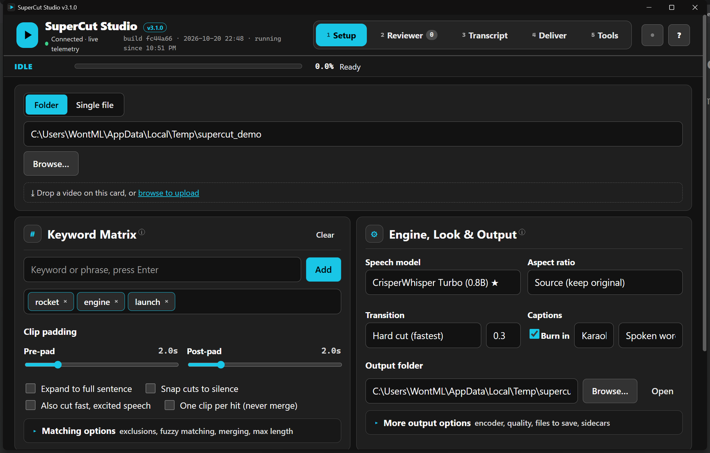
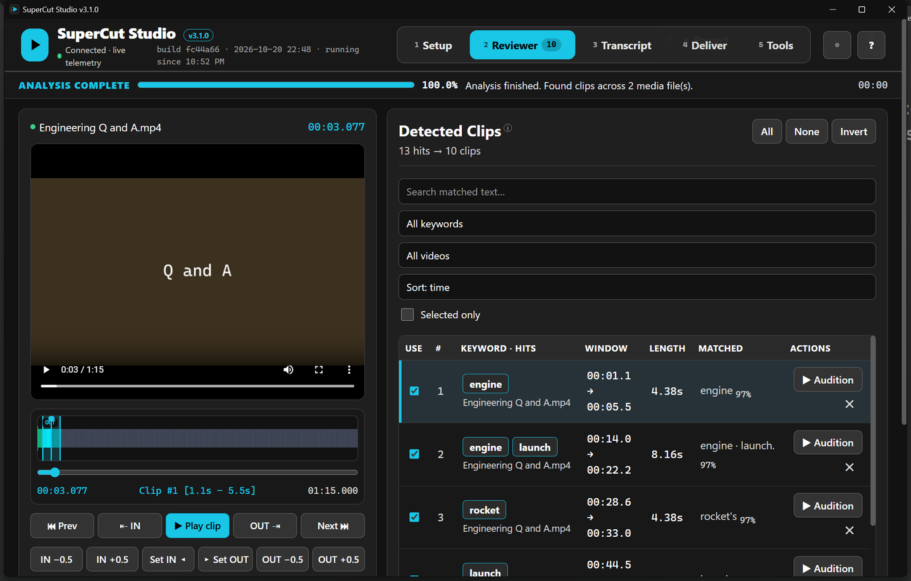

# SuperCut Studio

Point it at a folder of videos, type a few words, get back one video of every moment those
words were said.

It transcribes each file with word-level timestamps, finds the keyword hits, lets you check
and trim each clip before anything is rendered, then stitches the keepers into a master cut with
the GPU. Captions, subtitles, thumbnails and NLE timelines come out alongside it.



## What it does

- Transcribes with CrisperWhisper Turbo (verbatim, tight word timing) or faster-whisper. Transcripts
  are cached per file, so changing keywords and re-running is instant.
- Matches plurals and possessives on its own: `sister` finds *sisters* and *sister's*. Phrases,
  exclusions and fuzzy matching are there if you need them.
- Pads each hit, optionally pushes the edges out to the full sentence, and either merges hits
  that run together or keeps one clip per hit. Your call.
- Reviewer tab: waveform, scrubber, IN/OUT trimming from the keyboard, audition any clip, tick the
  ones to keep.
- Renders with NVENC when there is an NVIDIA card and falls back to CPU when there is not. Only
  the clip ranges are decoded, so a two-hour source does not take two hours.
- Writes a job folder per render: the master cut at the top, `highlights/` per source video,
  `clips/` for the individual cuts, and `extras/` for SRT, VTT, ASS, Premiere/FCP XML, DaVinci
  EDL, thumbnails, contact sheets and reports.
- Optional burned-in karaoke captions in five styles.



## Install

Download `SuperCutStudio-Setup-<version>.exe` from the
[releases page](https://github.com/Wontfallo/SuperCutStudio/releases) and run it. It installs per
user, no admin prompt, with FFmpeg bundled. Launch **SuperCut Studio** from the Start menu.

The first run with a Whisper model downloads it into the Hugging Face cache, so that one needs
internet. After that it works offline.

CrisperWhisper Turbo is optional. It needs a Python 3.12 environment with the `crisperwhisper`
package; the app looks for `crisper-venv` next to it or the interpreter named by
`VKS_CRISPER_PYTHON`. If it is not there the app says so and uses faster-whisper instead.

Settings, caches and logs live in `%LOCALAPPDATA%\SuperCutStudio`. Renders default to
`Videos\SuperCut Output`.

## Run from source

Python 3.10 or newer, FFmpeg on `PATH` (or set `VKS_FFMPEG`), Node.js only if you want the
browser test suite.

```bat
setup.bat
run_desktop.bat
```

`run_web_studio.bat` serves the same UI in your browser instead of a native window.

Command line, no UI:

```bat
venv\Scripts\python cli.py -i "D:\Videos" -k "launch,rocket" -a 9:16 -t crossfade --subtitles
```

## Build the installer

```bat
build_installer.bat
```

That runs the tests, copies FFmpeg into the bundle, runs PyInstaller with
`build\SuperCutStudio.spec` and compiles `build\installer.iss` with Inno Setup
(`winget install JRSoftware.InnoSetup`). The result lands in `dist\`. Flags for the PowerShell
script underneath: `-SkipTests`, `-NoFfmpeg`, `-NoInstaller`, `-CloseRunning`, `-FfmpegDir <path>`.

## Tests

```bat
venv\Scripts\python -m pytest -q
node tests\test_browser_frontend.js
```

The pytest suite covers matching, clip boundaries, subtitles, exports, encoder fallbacks, a live
FFmpeg end-to-end run and the HTTP API. The Node suite drives the real single-page app in JSDOM.

## Layout

```
desktop.py        native window shell, PyInstaller entry point
web_app.py        FastAPI server, JSON + SSE API, serves static/ inlined
static/           index.html, app.css, app.js (no CDN, works offline)
cli.py            command-line pipeline
supercut/         engine: pipeline, asr/, audio/, search/, video/, export/, server/
build/            PyInstaller spec, Inno Setup script, build script
tests/            pytest + JSDOM suites
```

## Reviewer shortcuts

`Space` play/pause · `J`/`L` ±2 s · `←`/`→` ±0.1 s · `S` toggle clip · `N`/`P` next/previous ·
`Enter` play clip · `I`/`O` set IN/OUT · `[`/`]` nudge · `Home`/`End` jump · `Delete` remove ·
`1`–`5` tabs · `Esc` stop job · `?` help

## Licenses

CrisperWhisper weights are licensed by Nyra Labs for non-commercial research. The bundled FFmpeg
is a GPL build from gyan.dev.
